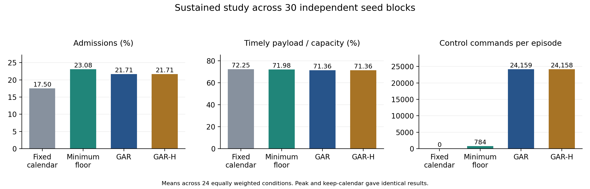

# GAR revision results and resubmission assessment

OJCOMS-07411-2026. Results from the 11 November 2026 campaign in UAE local time.

GAR improved temporary admissions over the fixed calendar. The request-triggered minimum-floor baseline achieved higher admissions, timely payload efficiency and tenant bytes with about one-thirtieth as many plan commands. The GAR-H screen changed these averages very little. The paper can present the conditional safety certificate and the cost of periodic replanning. A performance-superiority claim for GAR or GAR-H would require different evidence.

## Evidence and reproducibility

The campaign accounts for 12,162 task rows. Of these, 12,042 completed and 120 were rejected at provisioning. Acquisition, calibration, scaling, reproduction and all six experimental shards completed successfully. The pilot and calibration recovery imported 1,272 completed preparation receipts, including the separate pilot benchmark. The original failed attempt remains in the source campaign.

The audit matched every metrics row to its expected task ID and configuration, regenerated the three frozen manifest hashes, and checked common input fingerprints. It reproduced the nine original paired contrasts, including the confidence intervals and Holm-adjusted p-values. It also reproduced the seven selected reliability operating points from the development and test tables. The source archive contains episode metrics and recorded coverage. Raw task receipts, request ledgers, calendars and 30-second segment traces remain on the cluster and are needed for further event-level analysis.

| Evidence | Location |
|---|---|
| Source used on the cluster | [b132708](https://github.com/rtqayyum/gar-industry4-6g/tree/b132708b398c68402b2e8135693dd8d7ea6e39c8) |
| Original HPC bundle | [report_bundle.zip](../data/revision/20261110T213221767421Z-b132708b/report_bundle.zip) |
| Verified counts and hashes | [audit.json](../data/revision/20261110T213221767421Z-b132708b/audit/audit.json) |
| Derived result tables | [Audit outputs](../data/revision/20261110T213221767421Z-b132708b/audit) |
| Reproduction script | [audit_revision.py](../analysis/audit_revision.py) |
| Follow-up matched snapshot controls | [Replay results and reproduction command](../data/revision/matched_snapshot_controls/) |

Recreate the audit in a new directory using the repository's Python dependencies.

```bash
python3 analysis/audit_revision.py data/revision/20261110T213221767421Z-b132708b/report_bundle.zip --output runs/revision-results-audit
```

## Sustained operation and the strongest baseline

E1 contains 3,600 episodes. Each method receives the same inputs for four workload families, three loads, two request pressures and 30 independent seed blocks. Episodes offer traffic and requests for 300 seconds followed by a common drain. The table uses equal weights across the 24 conditions. Timely payload efficiency divides on-time bytes across all classes and tenants by nominal capacity over the episode and drain. Tenant bytes per offer includes rejected requests in the denominator.

| Method | Admission (%) | Timely payload efficiency (%) | Timely tenant bytes per offer | Mean plan commands |
|---|---:|---:|---:|---:|
| Fixed calendar, peak and keep-calendar | 17.50 | 72.25 | 6,520.40 | 0 |
| Minimum floor | 23.08 | 71.98 | 7,131.88 | 784.42 |
| GAR | 21.71 | 71.36 | 7,042.13 | 24,158.89 |
| GAR-H | 21.71 | 71.36 | 7,042.18 | 24,158.40 |



The fixed-calendar controls coincide because both start from a constant certified tail and leave it installed. The minimum-floor comparator can replace that calendar in response to a request. It searches for the lowest certified pulse over the request's duration and checks the activation prefix, subsequent tail and existing commitments. GAR uses the same request-triggered search and also revisits the calendar at periodic control ticks. This comparison measures the added value of periodic replanning on top of a common certified admission mechanism.

| GAR difference | Against the fixed calendar, 95% CI | Against minimum floor, 95% CI |
|---|---:|---:|
| Admission, percentage points | +4.213 [4.181, 4.244] | −1.370 [−1.392, −1.345] |
| Timely payload efficiency, percentage points | −0.897 [−0.910, −0.882] | −0.625 [−0.635, −0.613] |
| Timely tenant bytes per offer | +521.73 [517.13, 526.19] | −89.75 [−93.18, −86.35] |

The fixed-calendar interval above uses the recorded `peak` contrast. The independent blocks are the 30 seeds, each containing all paired conditions. All nine original tests have Holm-adjusted p = 0.00045 to the reported precision. The identical fixed-calendar outcomes represent one comparator behaviour. The command ratio and GAR-H comparison are descriptive.

GAR used 30.8 times as many accepted plan commands as minimum floor. GAR-H changed mean admissions by +0.00116 percentage points and timely tenant bytes by +0.047 per offer relative to GAR. The largest family-level admission deficit against minimum floor was in regime shift, at −3.62 points. At load 1.0 with 10 requests per second in that family the deficit was −8.31 points. Some other cells favoured GAR on admission, while its command count exceeded minimum floor in every paired E1 episode.

Across E1, all methods recorded zero critical misses, protected background failures and accepted tenant failures. The same counts were zero across all 8,550 completed sustained episodes that met the declared assumptions, including the pilot. These observed outcomes support the model evaluation. A deployment reliability target requires measured exposure and a service model for the execution environment.

## Reliability, sensitivity and deployment limits

**E2.** The development sweep considered six configurations for each of four online adapters. Separate test seeds evaluated the selected configurations over 30 blocks. All seven attainable points met their target using the upper endpoint of the reported 95% bootstrap interval. The three points selected at 3% had 2.582% mean background failure and 0% admissions. Every method missed the 1% threshold in the tested development grid, and the Yu-style adapter also missed 3%. The four 5% points admitted 27.86% to 33.50% of requests and achieved 59.07% to 63.19% timely payload efficiency, with realized background failure between 3.22% and 3.68%. These comparisons share a ceiling on empirical failure. Their realized reliability differs. The four adapters are gateway implementations inspired by prior methods. Minimum floor appears in the sustained study, and the selected online points concern this separate best-effort model.

**E3.** The 120 provisioning rejections occur at capacity 325 bytes/ms with load 0.8 or capacity 650 bytes/ms with load 1.4. Each setting accounts for 60 cases across the same two families, three methods and ten seeds. There are 660 extra tasks whose numeric settings equal another task with the same seed and method because the manifest distinguishes some integer and floating-point encodings. Their recorded scientific outcomes match. The audit retains all task rows and counts the 3,900 distinct numeric configurations and seeds once in sensitivity summaries. At zero activation delay, mean admissions were 18.13% for GAR and 19.01% for minimum floor. The difference therefore persists in that diagnostic. Increasing the command price from 64 to 256 reduced mean GAR commands from 6,492 to 1,155 in the 60-second sensitivity episodes. Minimum floor used 551. The higher command price is a development lead. A claim about a policy chosen after inspecting these results needs a fresh holdout.

**E4.** The median of per-fixture p95 planning times rose from 75.3 microseconds at 512 slots to 5.083 milliseconds at 32,768 slots. At the largest horizon all 30 fixture p95s exceeded 5 milliseconds, and the largest measured call took 5.412 milliseconds. Fixture construction is timed separately. The benchmark times `guarded_decision` after calendar construction. End-to-end admission, state construction from a live ledger and installation need separate measurements. All fixtures report the same 26,940 KiB process RSS high-water mark, which provides no resolution for algorithm memory growth. The candidate-floor sweep uses a fixture with a high required tail. A wider performance claim needs cases that exercise different search lengths and real booking-state construction.

**E5.** All 300 controller interruption episodes completed. Existing commitments met their deadlines while the local executor continued, including interruptions of five seconds. During interruptions the model rejects new admissions. Durable gateway restart, acknowledgement recovery and persistent timer restoration remain separate verification tasks.

**E6.** All 90 episodes using the declared lower service bound recorded zero critical, protected background and tenant failures. The 90 unannounced-drop episodes recorded 187,458 critical failures and 9,636 accepted tenant failures in total across the three methods. Even the 5% unannounced drop caused 2,158 tenant failures across the matched runs while critical misses remained at zero. These totals count repeated paired workloads across policies. The stress test concerns delivered service in a single gateway. Wireless and multi-hop claims require measured service bounds and composition evidence.

## Reviewer evidence and remaining work

The identifiers below follow the revision plan's working labels. The final response letter still needs the original wording of every comment and the location of each revised passage.

| Plan item | Evidence available | Remaining action |
|---|---|---|
| R1 A and R1 B, references and admission counts | E0 reproduction completed | Check bibliography and reconcile 2,029 versus 2,048 against the original ledger, cohort and denominator. |
| R1 C, R2 A and R2 B, realism, network scope and envelopes | Generated contracts, matched inputs and lower-supply stress | State synthetic traffic provenance. Obtain an independent timestamped industrial trace and evaluate service composition for any broader claim. |
| R1 D, GAR-H trade-offs | E1 gives a near-zero incremental effect. E2 documents admission and reliability trade-offs for online adapters. | Revise GAR-H claims. The live packet comparison and defensible host service bound remain open. |
| R1 E and R3 C, algorithm and tail proof | Candidate proof and operational algorithm in the repository | Integrate and independently review the proof, event order, installation and expiry, including the activation prefix and continuation cases. |
| R1 F and R2 F, sustained histories | 3,600 matched episodes with persistent state and accepted-interval checks | Add 30-second segment and ledger summaries from the retained task files. |
| R2 C and R2 G, background protection and comparable reliability | Protected service in E1, independent development and test seeds in E2 | Present the shared ceilings and realized failure rates, including the 3% points with zero admissions. |
| R2 D and R3 E, cost and capacity drops | Planning time curves, infeasible configurations and service-drop failures | Measure complete decision cost and incremental memory with suitable fixtures before making implementation-budget claims. |
| R2 E, crash recovery | Controller interruption cases | Validate durable gateway restart and the consequences of data-plane interruption. |
| R3 A and R3 B, provisioning and controls | Common capacity and contracts, strong minimum-floor baseline and zero-delay diagnostic | Report the baseline advantage and extract reserved resource-time and rejection reasons to explain it. |
| R3 D and R3 F, notation and relation to prior updates | Declared parameters and documented comparator interface | Reconcile notation, justify parameter choices and explain the technical distinction from prior network update mechanisms. |
| Associate editor, evidence and claims | Complete numerical campaign and audited main comparisons | Align the abstract, contribution list, figures and responses with the results and deployment scope. |

The next analysis should use the retained per-task rejection reasons, reserved critical and tenant resource-time, 30-second segments and calendar changes. These records can test whether periodic replacements consume capacity that otherwise remains available for later bookings. They can also quantify renewal activity and serialized pending replacements. The current bundle gives episode-level outcomes, so the causal explanation remains provisional.

### Manuscript results paragraph

> Across 3,600 matched sustained episodes, GAR increased the admission rate by 4.21 percentage points over the fixed calendar. The request-triggered minimum-floor baseline achieved a further 1.37 percentage points of admission and required substantially fewer plan commands. All methods met the protected deadlines under the declared workload and service assumptions. The optional headroom screen had a negligible effect on aggregate outcomes in this study.

Use the existing results to revise the certificate and admission mechanism as the contribution. Keep the strong comparator and the unfavourable results in the main paper. The resubmission still needs the proof integration, historical count reconciliation, a point-by-point response and either supporting deployment evidence or narrower deployment claims.
